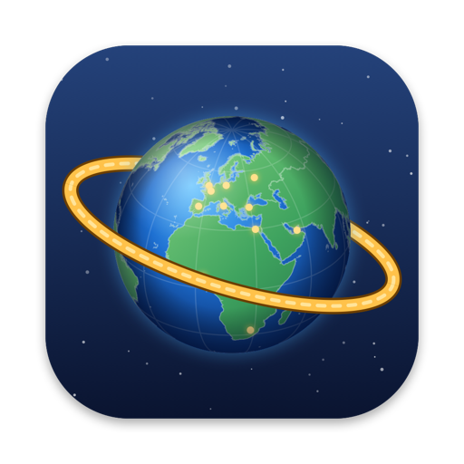
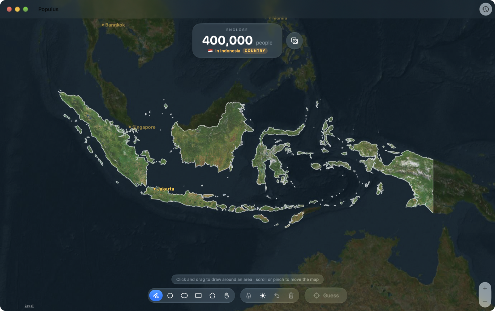

<p align="center">
  
</p>

<h1 align="center">Populus</h1>

<p align="center">Lasso the right number of people on a real map of the world.</p>

<p align="center">
  
</p>

Populus is a macOS game. Each round gives you a target, like "enclose 7.5 million people in Indonesia". Draw a shape on the map, press Return, and see how close you got, based on real population data down to 100 m squares.

<p align="center">
  <a href="https://github.com/gxlactuss/Populus/releases/latest"><b>⬇️ Download Populus for Mac</b></a>
</p>

---

## How to install (no technical knowledge needed)

You need a Mac running **macOS 26 or later**. It works on both Apple Silicon and Intel Macs.

**Step 1. Download the app**

Go to the [latest release page](https://github.com/gxlactuss/Populus/releases/latest). Scroll down to the **Assets** section and click the file whose name ends in **`.dmg`** (for example `Populus-1.1.0.dmg`). It is about 250 MB, so it may take a minute.

**Step 2. Open the file you downloaded**

Open your **Downloads** folder and double-click the `.dmg` file. A window opens showing the Populus icon and an Applications folder.

**Step 3. Install it**

Drag the **Populus** icon onto the **Applications** folder in that window. Wait for it to finish copying, then close the window.

**Step 4. Open it the first time**

Populus is free and not registered with Apple, so the first time you open it your Mac will show a warning and refuse to open it. This is normal. To allow it:

1. Open your **Applications** folder and double-click **Populus**. When the warning appears, click **Done** (or **OK**).
2. Click the **Apple logo** at the top left of the screen and choose **System Settings**.
3. Click **Privacy & Security** in the sidebar, then scroll down.
4. Next to the message about Populus, click **Open Anyway**, then confirm with your password or Touch ID.

You only have to do this once. After that, Populus opens like any other app, from your Applications folder or Launchpad.

**Updating:** when a new version is out, Populus tells you on launch. Download the new `.dmg` and repeat Steps 1 to 3. If asked, choose **Replace**.

<details>
<summary>For advanced users</summary>

There is also a `.zip` on the release page if you prefer it. Instead of Step 4, you can run this in Terminal:

```sh
xattr -dr com.apple.quarantine /Applications/Populus.app
```

</details>

---

## How to play

- Each round is one of: anywhere on Earth, a continent, a country, or a city. The map keeps you inside that area.
- Draw with freehand (F), circle (C), ellipse (E), rectangle (R) or polygon (P). Hold Space or use pan (H) to move the map.
- Press Return to guess. You get your total, how far off you were, and the biggest cities inside your shape.
- After guessing, Cmd-Shift-D shows a population heatmap so you can see where people really live.
- Cmd-D switches between day (satellite) and night (city lights) maps. Cmd-Y opens your history.
- The share button in the results sends a picture of your shape and score, plus a line of text.
- In Settings (Cmd-,) you can turn round types on or off, for example cities only, and set the music volume.

## Build from source

You need Xcode 26 and [XcodeGen](https://github.com/yonaskolb/XcodeGen) (`brew install xcodegen`).

```sh
git clone https://github.com/gxlactuss/Populus.git
cd Populus
Scripts/fetch_data.sh        # downloads the ~220 MB of data files
xcodegen generate
open Populus.xcodeproj
```

The data files are too big for git, so they are attached to the [`data-v1` release](https://github.com/gxlactuss/Populus/releases/tag/data-v1). To rebuild them from the original sources instead, see the scripts in `Scripts/` (run them with [uv](https://docs.astral.sh/uv/)):

| Script | Makes |
| --- | --- |
| `build_data.py` | The world population grids and the city list used in results |
| `build_regions.py` | Continent and country masks and borders |
| `build_metros.py` | 100 m population grids for each city round |
| `make_icon.swift` | The app icon |

To make a release, run `Scripts/package_release.sh`. Upload the app `.dmg` and `.zip` in `dist/` to the version release, and `populus-data.zip` to `data-v1` if the data changed.

## Report a problem

In the app, choose Help > Report an Issue. It opens a new GitHub issue with your app and macOS versions filled in. You can also [open an issue](https://github.com/gxlactuss/Populus/issues/new/choose) directly.

## Privacy

Populus has no accounts, analytics or tracking. Your history stays on your Mac. The app only goes online to load Apple Maps and NASA's night lights images, and to check GitHub for a new release once per launch. You can turn the update check off in Settings.

## Credits

### Inspiration

Populus was inspired by [Headcount](https://flightq.app/headcount) from FlightQ, a browser game where you draw a loop on a map to enclose a target population. Credit to them for the idea.

No code, art or data was taken from Headcount. Populus was written from scratch, and it adds a lot of its own on top of that core idea, including:

- Rounds locked to a continent, a country or a city, with borders drawn on the map
- 100 m population grids for 77 major cities
- Several drawing tools, moving shapes and undo
- Day satellite and night city lights maps
- A population heatmap after each guess
- Results that list the biggest cities inside your shape
- A history of past rounds
- Round types you can pick, a first-run tutorial and shareable result cards

### Data

- **Population:** GHS-POP R2023A, 2025 estimates, from the European Commission, Joint Research Centre (JRC). Licensed under [CC BY 4.0](https://creativecommons.org/licenses/by/4.0/). Schiavina, M., Freire, S., Carioli, A., MacManus, K. (2023): GHS-POP R2023A - GHS population grid multitemporal (1975-2030). European Commission, Joint Research Centre (JRC). [doi:10.2905/2FF68A52-5B5B-4A22-8F40-C41DA8332CFE](https://doi.org/10.2905/2FF68A52-5B5B-4A22-8F40-C41DA8332CFE). The data was resampled and cut into tiles for the app.
- **Borders and places:** [Natural Earth](https://www.naturalearthdata.com/) 1:10m Admin 0 Countries and Populated Places. Public domain. Made with Natural Earth.
- **Night lights:** NASA VIIRS Black Marble. We acknowledge the use of imagery provided by services from NASA's Global Imagery Browse Services ([GIBS](https://www.earthdata.nasa.gov/gibs)), part of NASA's Earth Science Data and Information System (ESDIS).
- **Map imagery:** Apple Maps, through MapKit. The map's Legal link has the details for Apple's data providers.

### Music

Background music by [Komiku](https://opengameart.org/users/loyalty-freak-music) (Loyalty Freak Music), released under [CC0](https://creativecommons.org/publicdomain/zero/1.0/). The tracks were loudness-matched and converted to AAC for the app.

- [Chill Out Theme](https://opengameart.org/content/chill-out-theme), [Time](https://opengameart.org/content/time) and [Down the river](https://opengameart.org/content/down-the-river), from *It's time for adventure vol 2*
- [Champ de tournesol](https://opengameart.org/content/champ-de-tournesol), from *It's time for adventure*
- [Friends, 2018](https://opengameart.org/content/friends-2018), from *Tale on the Late*
- Travel to the Horizon, Sunset on the beach and Quiet Saturday, from [*Poupi's incredible adventures!*](https://opengameart.org/content/poupis-incredible-adventures-full-album)

### Software

- Swift, SwiftUI and MapKit from Apple
- [XcodeGen](https://github.com/yonaskolb/XcodeGen) for the Xcode project
- [uv](https://docs.astral.sh/uv/), [NumPy](https://numpy.org/), [rasterio](https://rasterio.readthedocs.io/), [pyshp](https://github.com/GeospatialPython/pyshp), [SciPy](https://scipy.org/) and [Shapely](https://shapely.readthedocs.io/) for the data scripts

## License

The code is licensed under the [Apache License 2.0](LICENSE). The data keeps its own licenses, listed above and in [NOTICE](NOTICE).
